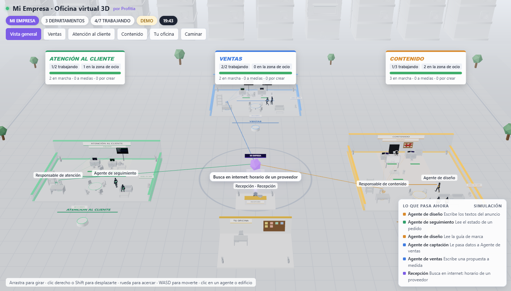

# Centro de agentes 3D · corestack_systemc

Un **centro de agentes en 3D de planta abierta** donde ves trabajar a tus equipos: cada departamento es una zona con el color de tu marca, cada agente tiene su mesa, y los ves **trabajar, consultarse, entregar a su responsable y descansar** en la zona de ocio. Encima de cada uno flota el holograma de lo que está haciendo.

Es una web **estática**: sin servidor, sin base de datos y sin claves. Se publica gratis en Vercel en unos minutos.

> Basado en la plantilla de [Profitia](https://profitia.digital) — IA para negocios. Si te sirve, deja una ⭐ en el repo.



---

## Qué incluye

| | |
|---|---|
| 🧩 **Una zona por departamento** | Plataforma abierta, zócalo bajo, borde del color del departamento, rótulos, un puesto por agente y zona de reuniones. Hasta 5 departamentos. |
| 🤖 **Agentes animados** | Personajes con esqueleto y animación real (andar, estar de pie, sentarse, teclear). Traje oscuro con las juntas iluminadas del color de su departamento; el responsable va de blanco. Sin caras. |
| 🪄 **Hologramas de tarea** | Mientras trabaja, sobre cada agente flota un holograma que cambia según la tarea (buscar en internet, leer, escribir) y su bocadillo dice qué hace. |
| 🛋️ **Zona de ocio** | Sofás, «barra de chips» y mesa de holojuegos donde los agentes se juntan por parejas. |
| 🪑 **Puestos según su función** | Ventas, captación, atención, contenido (con plató), desarrollo, servidores, laboratorio, finanzas… cada puesto se amuebla según su función. |
| 🚶 **Modo «Caminar»** | Recorre la oficina a pie, a la altura de los ojos (WASD o flechas; en móvil, botón ▲). |
| 📋 **Ficha y actividad** | Clic en un agente para ver quién es y qué hace. Panel «Lo que pasa ahora» con la actividad en directo. |
| 📱 **Funciona en todas partes** | Ordenador, tablet y móvil. |

> La actividad es una **simulación** con datos de ejemplo (empresa ficticia «Mi Empresa»). Las pantallas de pared muestran cifras inventadas marcadas como «demo».

---

## Instalación paso a paso

### Lo que necesitas

- Una cuenta gratis en **[GitHub](https://github.com)** y otra en **[Vercel](https://vercel.com)** (puedes entrar en Vercel con tu GitHub).
- Para probar en tu ordenador (opcional): **[Node.js 18 o superior](https://nodejs.org)**.

### Opción A · Publicar directamente (5 minutos, sin instalar nada)

1. Pulsa **Use this template → Create a new repository** (arriba a la derecha en GitHub) para tener tu propia copia.
2. En tu copia, abre **`oficina.config.js`**, pulsa el lápiz ✏️ y cambia el nombre de tu empresa, los departamentos y los agentes. Guarda con **Commit changes**.
3. Entra en **[vercel.com/new](https://vercel.com/new)**, elige tu repositorio y pulsa **Deploy** (no hace falta tocar ningún ajuste).
4. Listo: Vercel te da una dirección tipo `tu-oficina.vercel.app`. Cada vez que cambies algo en GitHub, se actualiza sola.

### Opción B · Probar primero en tu ordenador

```bash
git clone https://github.com/TU-USUARIO/TU-REPO.git
cd TU-REPO
npm run dev                     # abre http://localhost:8780
```

No hay que instalar nada (`npm install` no es necesario). También vale cualquier servidor estático, por ejemplo `npx serve`.

> Abrir `index.html` con doble clic **no funciona**: el navegador bloquea los modelos 3D fuera de un servidor. Usa `npm run dev`.

### Conectar la IA (opcional)

La ficha de cada agente puede responder con **Google Gemini**. La clave vive solo en el servidor, nunca en el navegador.

1. Saca una clave gratuita en **[aistudio.google.com/apikey](https://aistudio.google.com/apikey)**.
2. Copia `.env.example` a `.env` y pega la clave en `GEMINI_API_KEY`.
3. Reinicia `npm run dev` y prueba la conexión con `npm run probar-ia`.
4. En Vercel, añade `GEMINI_API_KEY` en **Settings → Environment Variables** y vuelve a desplegar.

> No pongas la clave en `oficina.config.js`, en `index.html` ni en GitHub. `.env` ya está protegido por `.gitignore`.

---

## Personalizar

Todo está en **`oficina.config.js`**:

| Campo | Qué cambia |
|---|---|
| `empresa`, `lema` | El nombre de la cabecera y el que flota sobre el núcleo central. |
| `colorCentral` | Color del núcleo central y de los botones. |
| `recepcion` | Nombre y tareas de la recepción (o `false` para quitarla). |
| `departamentos[]` | Cada uno es una zona abierta: `id`, `nombre`, `color` y `zona` (rótulo del equipo). |
| `departamentos[].responsable` | Nombre y tareas del responsable (o `false` si no tiene). |
| `departamentos[].agentes[]` | `id`, `nombre`, `puesto`, `oficina` (tipo de mueble), `tareas` y, si quieres, `estado`: `'a_medias'` o `'no_existe'` (sale en obras). |

**Tipos de oficina:** `ventas`, `captacion`, `atencion`, `contenido`, `investigacion`, `desarrollo`, `entrega`, `finanzas`, `direccion`, `pizarra`, `servidores`, `seguridad`, `laboratorio`, `comunidad`, `academia`, `analitica`, `formacion`.

**Truco de los hologramas:** si una tarea empieza por «Busca en internet» sale un globo que gira; si empieza por «Lee», unas hojas; cualquier otra, líneas que se escriben.

**Otras cosas útiles:**
- `#ventas`, `#oficina`… al final de la dirección abre directamente esa vista.
- `?ps1` en la dirección activa el estilo consola de 1998.
- En la consola del navegador, `window.OFICINA3D` da acceso a la cámara, los controles y los agentes para depurar.
- Las cifras de las pantallas de pared están en la función `datosPared()` de `oficina3d.js`.

### Personalízala con Claude Code

Abre la carpeta del proyecto con [Claude Code](https://claude.com/claude-code) y pega esto (cambiando lo que va entre corchetes):

```text
Personaliza esta oficina virtual 3D para mi negocio: [una línea sobre tu negocio, p. ej. «una clínica dental con 2 sedes»].
Edita solo oficina.config.js: pon el nombre de mi empresa, entre 2 y 5 departamentos que tengan sentido para mi negocio
con colores que combinen con mi marca [color principal], y de 1 a 4 agentes por departamento con nombres de rol genéricos,
el tipo de oficina que mejor encaje y 3 tareas cortas y realistas cada uno (empieza alguna por «Busca en internet» o «Lee»).
No inventes cifras ni nombres de clientes reales. Después ejecuta `npm run check` y arranca `npm run dev` para que lo vea.
```

---

## Comprobar antes de publicar

```bash
npm run check
```

Revisa que la configuración cargue, que existan todos los modelos 3D que pide el código y que la web no llame a ningún servidor.

---

## Estructura

```
├── index.html              La página (cabecera, vistas, ficha y panel de actividad)
├── oficina.config.js       ← TU CONFIGURACIÓN
├── oficina3d.js            El mundo 3D (three.js): planta, zonas, agentes y simulación
├── modelos/
│   ├── muebles/            Muebles (Kenney Furniture Kit, CC0)
│   ├── ciudad/             Modelos de edificios de la plantilla original (no se usan en la planta abierta)
│   └── personas/xbot.glb   Personaje animado (ejemplos de three.js)
├── vendor/                 three.js y sus complementos (MIT)
├── herramientas/           Servidor local y comprobador
└── CREDITOS.md             Licencias de los recursos de terceros
```

---

## Licencia

[MIT](LICENSE) © Profitia. Puedes usarlo, modificarlo y venderlo; solo mantén el aviso de copyright.

Los recursos de terceros tienen su propia licencia: modelos de **Kenney** (CC0), **three.js** (MIT) y el personaje **Xbot** de los ejemplos de three.js. Detalle en **[CREDITOS.md](CREDITOS.md)**. La empresa, los agentes y las cifras de ejemplo son ficticios: sustitúyelos por los tuyos.
